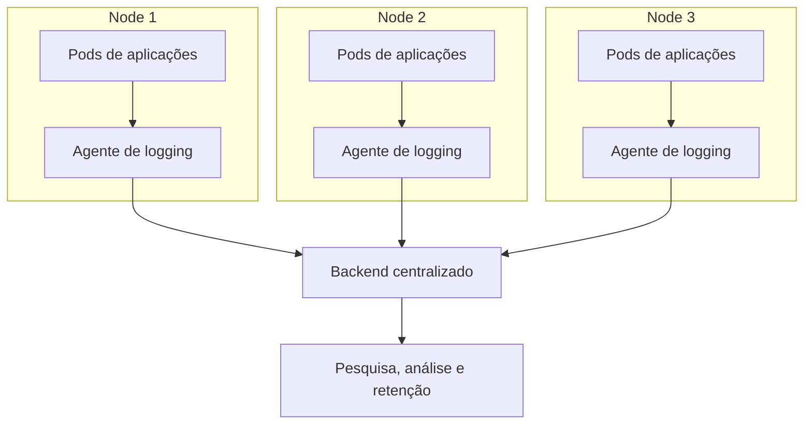
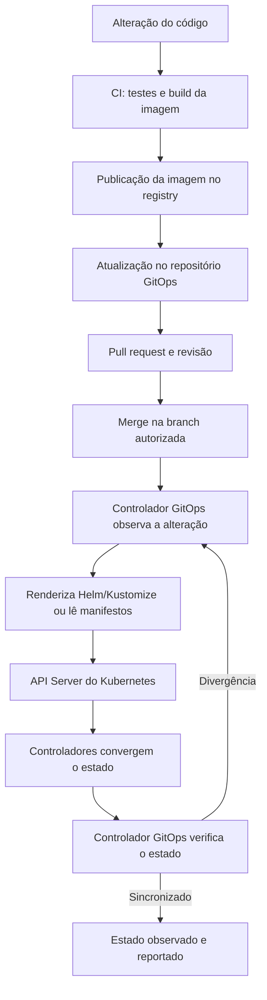

# Administrando logs e implantando aplicações no Kubernetes — Guia de comandos


## 1. Logging básico no Kubernetes

O mecanismo padrão de logs do Kubernetes consulta as mensagens emitidas pelos containers em `stdout` (*standard output*) e `stderr` (*standard error*). O runtime captura essas saídas e o `kubelet` disponibiliza os registros por meio da API do Kubernetes.

### Criar um Pod de demonstração

Salve o manifesto a seguir como `log-demo.yaml`:

```yaml
apiVersion: v1
kind: Pod
metadata:
  name: log-demo
spec:
  containers:
    - name: contador
      image: busybox:1.36.1
      command: ["/bin/sh", "-c"]
      args:
        - 'i=0; while true; do echo "$i: $(date)"; i=$((i+1)); sleep 1; done'
```

Crie o Pod e consulte seus logs:

```bash
# Criar ou atualizar o Pod a partir do manifesto
kubectl apply -f log-demo.yaml

# Consultar as mensagens emitidas pelo container
kubectl logs log-demo

# Acompanhar novas mensagens em tempo real
kubectl logs -f log-demo

# Remover o Pod de demonstração
kubectl delete pod log-demo
```

`kubectl logs` não lê qualquer arquivo existente no sistema de arquivos do container. Para que os registros apareçam automaticamente nesse comando, a aplicação deve escrevê-los em `stdout` ou `stderr`.

> [!NOTE]
> **Para saber mais**
> - [Kubernetes Documentation | Logging Architecture](https://kubernetes.io/docs/concepts/cluster-administration/logging/)

---

## 2. Consultar logs de Pods e containers

### Localizar Pods e consultar seus detalhes

```bash
# Listar Pods de todos os Namespaces e mostrar os Nodes
kubectl get pods -A -o wide

# Consultar detalhes, estado e eventos associados a um Pod
kubectl describe pod <POD> -n <NAMESPACE>

# Consultar os logs do container padrão do Pod
kubectl logs <POD>

# Consultar os logs indicando o Namespace
kubectl logs <POD> -n <NAMESPACE>
```

### Selecionar um container

Quando um Pod possui mais de um container, informe o nome com `-c` ou `--container`.

```bash
# Logs de um container específico
kubectl logs <POD> -c <CONTAINER> -n <NAMESPACE>

# Logs de todos os containers do Pod
kubectl logs <POD> --all-containers=true -n <NAMESPACE>

# Acompanhar em tempo real um container específico
kubectl logs -f <POD> -c <CONTAINER> -n <NAMESPACE>
```

### Consultar logs de uma instância anterior

Se o container foi reiniciado e ainda existem logs da instância anterior disponíveis, utilize `--previous` ou `-p`.

```bash
# Logs da instância anterior do container padrão
kubectl logs <POD> --previous -n <NAMESPACE>

# Logs da instância anterior de um container específico
kubectl logs <POD> -c <CONTAINER> --previous -n <NAMESPACE>
```

`--previous` não recupera todas as instâncias históricas; consulta a instância anterior quando ela ainda está disponível.

### Filtrar por quantidade de linhas, período e timestamp

```bash
# Mostrar as últimas 100 linhas
kubectl logs <POD> --tail=100 -n <NAMESPACE>

# Mostrar mensagens dos últimos dez minutos
kubectl logs <POD> --since=10m -n <NAMESPACE>

# Incluir timestamp em cada linha
kubectl logs <POD> --timestamps=true -n <NAMESPACE>

# Consultar mensagens a partir de uma data/hora RFC3339
kubectl logs <POD> --since-time="2026-10-28T18:00:00Z" -n <NAMESPACE>
```

Os parâmetros `--since` e `--since-time` são alternativas entre si; não devem ser usados juntos no mesmo comando.

### Consultar logs de um Deployment ou Job

```bash
# Logs dos Pods associados a um Deployment
kubectl logs deployment/<DEPLOYMENT> -n <NAMESPACE>

# Logs dos Pods associados a um Job
kubectl logs job/<JOB> -n <NAMESPACE>

# Selecionar um container de um Deployment com vários containers
kubectl logs deployment/<DEPLOYMENT> -c <CONTAINER> -n <NAMESPACE>
```

### Consultar logs por label selector

```bash
# Logs dos Pods que correspondem ao seletor de labels
kubectl logs -l app=api -n <NAMESPACE>

# Logs de todos os containers, identificando a origem de cada linha
kubectl logs -l app=api \
  --all-containers=true \
  --prefix=true \
  --tail=100 \
  --max-log-requests=10 \
  -n <NAMESPACE>

# Acompanhar continuamente os logs dos Pods selecionados
kubectl logs -f -l app=api --all-containers=true --prefix=true -n <NAMESPACE>
```

Ao consultar vários Pods por seletor, use `--max-log-requests` para limitar as solicitações simultâneas quando houver muitas réplicas. A opção `--prefix` ajuda a identificar o Pod e o container que originaram cada linha.

### Consultar logs de componentes do sistema

```bash
# Listar Pods do Namespace de sistema
kubectl get pods -n kube-system -o wide

# Consultar logs de um componente executado em um Pod
kubectl logs <POD> -n kube-system
```

Se o Pod do componente tiver vários containers, informe `-c <CONTAINER>`. A disponibilidade dos logs depende de como o cluster foi instalado e das permissões do usuário.

### Consultar logs de serviços no Node

Em Nodes Linux com `systemd`, os logs do `kubelet` e do runtime frequentemente podem ser consultados pelo `journald`. Execute os comandos diretamente no Node, com as permissões administrativas necessárias:

```bash
# Logs do kubelet
sudo journalctl -u kubelet

# Logs do containerd
sudo journalctl -u containerd

# Exibir as últimas 100 mensagens do kubelet e acompanhar novas mensagens
sudo journalctl -u kubelet -n 100 -f
```

Em sistemas sem `systemd`, os registros podem estar em arquivos do diretório `/var/log`. Os caminhos e nomes variam conforme o sistema operacional, a distribuição Kubernetes e o runtime.

### Diferenciar logs de eventos

Logs contêm mensagens emitidas por aplicações ou componentes. Events registram ocorrências reportadas por objetos e componentes do Kubernetes, como falhas de agendamento, reinícios e problemas ao baixar imagens.

```bash
# Listar eventos do Namespace, ordenados pela criação
kubectl get events -n <NAMESPACE> --sort-by=.metadata.creationTimestamp
```

Os eventos complementam a investigação, mas não substituem os logs da aplicação.

> [!NOTE]
> **Para saber mais**
> - [Kubernetes Documentation | kubectl logs](https://kubernetes.io/docs/reference/kubectl/generated/kubectl_logs/)
> - [Kubernetes Documentation | System Logs](https://kubernetes.io/docs/concepts/cluster-administration/system-logs/)

---

## 3. Arquitetura de logging em nível de cluster

O Kubernetes permite consultar logs recentes dos containers, mas não oferece, por si só, um backend centralizado de armazenamento, pesquisa e retenção. Para manter registros independentemente da vida útil de Pods e Nodes, é necessária uma solução de logging em nível de cluster.

### Abordagens de coleta

| Abordagem | Funcionamento | Considerações |
| --- | --- | --- |
| Agente no nível do Node | Coleta logs locais e os envia a um backend. Costuma ser implantado como `DaemonSet`, com um agente por Node elegível. | É uma abordagem comum quando as aplicações já escrevem em `stdout` e `stderr`. |
| Sidecar | Container adicional no mesmo Pod coleta arquivos ou encaminha logs. | Pode ser útil para formatos ou arquivos especiais, mas eleva o consumo de CPU, memória e armazenamento. |
| Envio pela aplicação | A aplicação envia eventos diretamente a um backend. | Exige integração na aplicação e planejamento para lidar com falhas de entrega. |

Uma arquitetura comum utiliza um agente por Node e um backend independente:



### Opções de soluções centralizadas

| Solução ou componente | Função | Considerações |
| --- | --- | --- |
| Grafana Alloy | Coletor e encaminhador | Pode enviar logs ao Loki ou a outros destinos compatíveis. |
| Fluent Bit | Coletor e processador leve | Pode ser executado como `DaemonSet`, lendo logs do Node e acrescentando metadados Kubernetes. Não é, por si só, um backend completo. |
| OpenTelemetry Collector | Coleta, processa e exporta telemetria | Pode padronizar a coleta de logs, métricas e rastros. Não substitui o backend de armazenamento e consulta. |
| Grafana Loki | Backend de logs | Utiliza labels como elemento central de indexação. Planeje as labels para evitar cardinalidade muito alta. |
| Elastic Stack | Elastic Agent, Elasticsearch e Kibana; Logstash pode ser usado para processamento adicional | Oferece indexação, pesquisa textual, filtros e dashboards; requer dimensionamento de armazenamento e índices. |
| OpenSearch | OpenSearch, OpenSearch Dashboards; Fluent Bit e Data Prepper podem integrar a ingestão | Solução de indexação e pesquisa que pode ser autogerenciada ou utilizada em serviço gerenciado. |
| Amazon CloudWatch / Container Insights | Serviço gerenciado para ambientes AWS compatíveis | Avalie ingestão, consultas, armazenamento e retenção para controlar custos. |
| Google Cloud Logging | Serviço de logging integrado ao GKE | Pode exportar dados para BigQuery, Cloud Storage ou Pub/Sub. |
| Azure Monitor / Container Insights | Monitoramento de AKS e clusters compatíveis | Permite consultar logs no Azure Monitor e no Log Analytics. |
| Datadog | Plataforma comercial de observabilidade | O Datadog Agent pode coletar logs dos containers e encaminhá-los para pesquisa, painéis e alertas. |
| Splunk | Plataforma comercial de observabilidade e análise | Pode receber logs por meio da distribuição Kubernetes do OpenTelemetry Collector. |

O **coletor** e o **backend** são componentes diferentes. Ao escolher uma solução, considere volume de ingestão, custos, retenção, disponibilidade, metadados, segurança, controle de acesso, buffers durante indisponibilidade e facilidade de migração.

> [!WARNING]
> O Promtail chegou ao fim do ciclo de vida em **2 de março de 2026**. Para novas implantações, a aula recomenda avaliar Grafana Alloy ou outro coletor suportado. Ambientes que ainda usam Promtail devem considerar a migração documentada pela Grafana.

> [!NOTE]
> **Para saber mais**
> - [Kubernetes Documentation | Logging Architecture](https://kubernetes.io/docs/concepts/cluster-administration/logging/)
> - [Grafana Loki Documentation](https://grafana.com/docs/loki/latest/)
> - [Grafana Alloy Documentation](https://grafana.com/docs/alloy/latest/)
> - [Promtail — fim de ciclo de vida e migração](https://grafana.com/docs/loki/latest/send-data/promtail/)
> - [Elastic — Monitorar um cluster Kubernetes com Elastic Agent](https://www.elastic.co/docs/solutions/observability/get-started/quickstart-monitor-kubernetes-cluster-with-elastic-agent)
> - [OpenSearch — Log analytics com Fluent Bit e Data Prepper](https://docs.opensearch.org/latest/data-prepper/common-use-cases/log-analytics/)
> - [Fluent Bit — Kubernetes](https://docs.fluentbit.io/manual/installation/downloads/kubernetes)
> - [OpenTelemetry Collector e Kubernetes](https://opentelemetry.io/pt/docs/platforms/kubernetes/collector/)
> - [AWS — Container Insights](https://docs.aws.amazon.com/AmazonCloudWatch/latest/monitoring/ContainerInsights.html)
> - [Google Cloud — Coletar logs do GKE](https://docs.cloud.google.com/logging/docs/integrate/gke)
> - [Microsoft Learn — Monitorar o AKS](https://learn.microsoft.com/pt-br/azure/aks/monitor-aks)
> - [Datadog — Coleta de logs no Kubernetes](https://docs.datadoghq.com/containers/kubernetes/log/)
> - [Splunk — Coletar dados de Kubernetes com OpenTelemetry Collector](https://help.splunk.com/en/splunk-observability-cloud/manage-data/collect-infrastructure-metrics-and-logs/collect-infrastructure-metrics-and-logs/collect-kubernetes-data)

---

## 4. Rotação de logs

A rotação de logs limita o tamanho dos arquivos e controla quantos arquivos históricos são mantidos. Na configuração padrão, o `kubelet` administra a rotação dos logs de containers capturados pelo runtime por meio da CRI.

### Parâmetros de rotação

| Parâmetro | Valor padrão | Finalidade |
| --- | --- | --- |
| `containerLogMaxSize` | `10Mi` | Tamanho máximo do arquivo antes da rotação. |
| `containerLogMaxFiles` | `5` | Número máximo de arquivos mantidos por container. |
| `containerLogMaxWorkers` | `1` | Quantidade máxima de workers concorrentes para rotação. |
| `containerLogMonitorInterval` | `10s` | Intervalo entre verificações dos arquivos. |

Exemplo ilustrativo de uma configuração `KubeletConfiguration`:

```yaml
# Fragmento ilustrativo de KubeletConfiguration.
# Não é um manifesto de Pod e não deve ser aplicado com kubectl apply.
containerLogMaxSize: 20Mi
containerLogMaxFiles: 6
containerLogMaxWorkers: 2
containerLogMonitorInterval: 10s
```

Nesse exemplo, cada arquivo pode crescer até `20Mi` antes da rotação, e podem ser mantidos até seis arquivos por container. A configuração efetiva depende da distribuição Kubernetes e da forma como os Nodes são administrados; não há um comando `kubectl` portátil que altere diretamente a configuração de rotação de todos os Nodes.

A rotação local não equivale à retenção permanente. `kubectl logs` apresenta o conteúdo do arquivo de log atual; arquivos rotacionados mais antigos podem não estar disponíveis por esse comando. Se a aplicação gravar exclusivamente em arquivos próprios dentro do container, configure a rotação na aplicação ou adote uma solução específica.

> [!NOTE]
> **Para saber mais**
> - [Kubernetes Documentation | Logging Architecture — Log rotation](https://kubernetes.io/docs/concepts/cluster-administration/logging/)
> - [Kubernetes Documentation | Kubelet Configuration](https://kubernetes.io/docs/reference/config-api/kubelet-config.v1beta1/)

---

## 5. Preparar o ambiente para usar Helm

Helm é um gerenciador de pacotes para Kubernetes. Um **Chart** descreve os recursos e seus templates; uma **Release** é uma instalação específica de um Chart em um cluster e namespace.

### Verificar ferramentas e conexão com o cluster

```bash
# Versão do Helm
helm version

# Versão do cliente kubectl
kubectl version --client

# Contexto Kubernetes atual
kubectl config current-context

# Verificar a conectividade com o cluster
kubectl cluster-info
```

### Localizar e inspecionar Charts

Charts podem ser encontrados em repositórios Helm tradicionais ou registros OCI. O [Artifact Hub](https://artifacthub.io/) reúne informações sobre Charts publicados por diferentes projetos.

```bash
# Pesquisar Charts no Artifact Hub
helm search hub nginx

# Adicionar um repositório Helm tradicional
helm repo add <NOME-DO-REPOSITORIO> <URL-DO-REPOSITORIO>

# Atualizar índices dos repositórios configurados
helm repo update

# Pesquisar Charts dos repositórios locais configurados
helm search repo <TERMO>

# Listar os repositórios configurados
helm repo list

# Exibir metadados de um Chart
helm show chart <REPOSITORIO>/<CHART>

# Exibir valores padrão de um Chart
helm show values <REPOSITORIO>/<CHART>

# Baixar e descompactar um Chart para inspeção local
helm pull <REPOSITORIO>/<CHART> --untar
```

Substitua `<NOME-DO-REPOSITORIO>`, `<URL-DO-REPOSITORIO>`, `<REPOSITORIO>`, `<CHART>` e `<TERMO>` pelos valores reais do ambiente.

> [!NOTE]
> **Para saber mais**
> - [Helm Documentation | Introduction](https://helm.sh/docs/intro/introduction/)
> - [Helm Documentation | Quickstart Guide](https://helm.sh/docs/intro/quickstart/)

---

## 6. Instalar, atualizar e consultar releases Helm

### Instalar uma release

```bash
# Instalar um Chart de um repositório
helm install <NOME-DA-RELEASE> <REPOSITORIO>/<CHART> \
  --namespace <NAMESPACE> \
  --create-namespace \
  -f values.yaml

# Instalar um Chart de um diretório local
helm install catalogo ./catalogo \
  --namespace desenvolvimento \
  --create-namespace \
  -f ./catalogo/values-dev.yaml
```

`--namespace` define o namespace da release; `--create-namespace` solicita a criação do namespace quando ele ainda não existe; `-f` ou `--values` informa um arquivo de valores que sobrescreve os valores padrão do Chart. Uma instalação não garante que todos os recursos estejam prontos: confira `helm status` e os recursos com `kubectl`.

### Atualizar uma release

```bash
# Atualizar uma release existente
helm upgrade catalogo ./catalogo \
  --namespace desenvolvimento \
  -f ./catalogo/values-dev.yaml

# Instalar se não existir ou atualizar se já existir
helm upgrade --install catalogo ./catalogo \
  --namespace desenvolvimento \
  --create-namespace \
  -f ./catalogo/values-dev.yaml

# Aplicar uma alteração pontual em um valor
helm upgrade --install catalogo ./catalogo \
  --namespace desenvolvimento \
  --set replicaCount=3
```

Quando vários arquivos `-f` são fornecidos, os posteriores têm precedência sobre os anteriores. Valores definidos com `--set` também podem sobrescrever valores informados nos arquivos. Para configurações repetíveis por ambiente, arquivos versionados costumam ser mais adequados.

### Consultar uma release

```bash
# Listar releases do namespace
helm list --namespace desenvolvimento

# Exibir o estado de uma release
helm status catalogo --namespace desenvolvimento

# Exibir valores explicitamente aplicados
helm get values catalogo --namespace desenvolvimento

# Exibir todos os valores, incluindo padrões
helm get values catalogo --all --namespace desenvolvimento

# Exibir manifestos associados à release
helm get manifest catalogo --namespace desenvolvimento

# Consultar o histórico de revisões
helm history catalogo --namespace desenvolvimento

# Listar releases em todos os namespaces
helm list --all-namespaces
```

### Reverter ou remover uma release

```bash
# Retornar a release à revisão 1
helm rollback catalogo 1 --namespace desenvolvimento

# Remover a release
helm uninstall catalogo --namespace desenvolvimento
```

O rollback retorna a release gerenciada pelo Helm a uma revisão anterior. A remoção exclui recursos gerenciados pela release conforme o comportamento do Chart e dos recursos; dados persistentes e objetos externos ou não gerenciados podem exigir tratamento separado.

> [!NOTE]
> **Para saber mais**
> - [Helm Documentation | Charts](https://helm.sh/docs/topics/charts/)
> - [Helm Documentation | Chart Template Guide](https://helm.sh/docs/chart_template_guide/)
> - [Helm Documentation | Best Practices](https://helm.sh/docs/chart_best_practices/)
> - [Helm Documentation | Helm 4 Overview](https://helm.sh/docs/overview/)

---

## 7. Criar e validar um Chart Helm

### Gerar a estrutura inicial

```bash
# Criar um Chart chamado catalogo
helm create catalogo
```

A estrutura típica inclui `Chart.yaml`, `values.yaml` e o diretório `templates/`. O Helm 4 é apresentado na documentação oficial como versão principal; o formato de Chart `apiVersion: v2` permanece estável. O formato de Chart v3 do Helm 4 é experimental, portanto não deve ser adotado em produção sem avaliação de maturidade e compatibilidade.

### Definir os metadados em `Chart.yaml`

```yaml
apiVersion: v2
name: catalogo
description: Chart de exemplo para implantar a aplicação catalogo no Kubernetes
type: application
version: 0.1.0
appVersion: "1.0.0"
```

`version` é a versão do pacote Chart e deve ser atualizada quando o próprio Chart mudar. `appVersion` informa a versão da aplicação empacotada e não é atualizada automaticamente.

### Definir os valores padrão em `values.yaml`

```yaml
replicaCount: 2

image:
  repository: nginx
  tag: "stable"
  pullPolicy: IfNotPresent

containerPort: 80

service:
  type: ClusterIP
  port: 80
```

Os templates utilizam esses valores para configurar réplicas, imagem, porta do container e tipo e porta do Service.

### Criar o template do Deployment

Crie ou ajuste `templates/deployment.yaml`:

```yaml
apiVersion: apps/v1
kind: Deployment
metadata:
  name: {{ .Release.Name }}
  labels:
    app.kubernetes.io/name: {{ .Chart.Name }}
    app.kubernetes.io/instance: {{ .Release.Name }}
spec:
  replicas: {{ .Values.replicaCount }}
  selector:
    matchLabels:
      app.kubernetes.io/instance: {{ .Release.Name }}
  template:
    metadata:
      labels:
        app.kubernetes.io/name: {{ .Chart.Name }}
        app.kubernetes.io/instance: {{ .Release.Name }}
    spec:
      containers:
        - name: {{ .Chart.Name }}
          image: "{{ .Values.image.repository }}:{{ .Values.image.tag }}"
          imagePullPolicy: {{ .Values.image.pullPolicy }}
          ports:
            - name: http
              containerPort: {{ .Values.containerPort }}
```

### Criar o template do Service

Crie ou ajuste `templates/service.yaml`:

```yaml
apiVersion: v1
kind: Service
metadata:
  name: {{ .Release.Name }}
  labels:
    app.kubernetes.io/name: {{ .Chart.Name }}
    app.kubernetes.io/instance: {{ .Release.Name }}
spec:
  type: {{ .Values.service.type }}
  selector:
    app.kubernetes.io/instance: {{ .Release.Name }}
  ports:
    - name: http
      port: {{ .Values.service.port }}
      targetPort: {{ .Values.containerPort }}
```

O `selector` do Service corresponde à label definida nos Pods do Deployment, fazendo com que o Service encaminhe tráfego para os Pods daquela release.

### Definir valores por ambiente

Exemplo de `values-dev.yaml`:

```yaml
replicaCount: 1

image:
  repository: nginx
  tag: "stable"
  pullPolicy: IfNotPresent

service:
  type: ClusterIP
  port: 80
```

Exemplo de `values-prod.yaml`:

```yaml
replicaCount: 3

image:
  repository: nginx
  tag: "1.27.5"
  pullPolicy: IfNotPresent

service:
  type: ClusterIP
  port: 80
```

As versões de imagem são exemplos didáticos. Em produção, utilize uma versão mantida e aprovada, preferencialmente imutável conforme a política de imagens da organização.

### Validar, renderizar, instalar e empacotar

```bash
# Validar a estrutura e apontar problemas comuns
helm lint ./catalogo

# Renderizar os templates localmente
helm template catalogo ./catalogo

# Renderizar usando valores de desenvolvimento
helm template catalogo ./catalogo -f ./catalogo/values-dev.yaml

# Simular uma instalação sem persistir alterações
helm install catalogo ./catalogo --dry-run --debug

# Instalar ou atualizar a release com valores de desenvolvimento
helm upgrade --install catalogo ./catalogo \
  --namespace desenvolvimento \
  --create-namespace \
  -f ./catalogo/values-dev.yaml \
  --wait

# Consultar os recursos criados
kubectl get deployment,service,pods --namespace desenvolvimento

# Consultar o estado da release
helm status catalogo --namespace desenvolvimento

# Empacotar o Chart
helm package ./catalogo
```

`helm template` permite revisar o YAML produzido antes da implantação. A saída de renderização ou simulação pode conter informações sensíveis se o Chart criar recursos `Secret`; evite compartilhar saídas que contenham credenciais.

> [!NOTE]
> **Para saber mais**
> - [Helm Documentation | Introduction](https://helm.sh/docs/intro/introduction/)
> - [Helm Documentation | Quickstart Guide](https://helm.sh/docs/intro/quickstart/)
> - [Helm Documentation | Charts](https://helm.sh/docs/topics/charts/)
> - [Helm Documentation | Chart Template Guide](https://helm.sh/docs/chart_template_guide/)
> - [Helm Documentation | Best Practices](https://helm.sh/docs/chart_best_practices/)
> - [Helm Documentation | Helm 4 Overview](https://helm.sh/docs/overview/)

---

## 8. Criar uma base Kustomize

Kustomize personaliza manifestos Kubernetes convencionais por meio de arquivos YAML, sem exigir uma linguagem de templates. O arquivo principal é `kustomization.yaml` ou `kustomization.yml`; `kubectl` possui suporte integrado por `kubectl kustomize` e `kubectl apply -k`.

### Estrutura de diretórios

```text
kustomize-catalogo/
├── base/
│   ├── deployment.yaml
│   ├── service.yaml
│   └── kustomization.yaml
└── overlays/
    ├── desenvolvimento/
    │   └── kustomization.yaml
    └── producao/
        └── kustomization.yaml
```

A pasta `base/` contém recursos reutilizáveis; cada diretório em `overlays/` reutiliza a base e define alterações para um ambiente.

### Manifesto `base/deployment.yaml`

```yaml
apiVersion: apps/v1
kind: Deployment
metadata:
  name: catalogo
  labels:
    app: catalogo
spec:
  replicas: 2
  selector:
    matchLabels:
      app: catalogo
  template:
    metadata:
      labels:
        app: catalogo
    spec:
      containers:
        - name: catalogo
          image: registry.example.com/catalogo:1.0.0
          ports:
            - name: http
              containerPort: 8080
```

A imagem é ilustrativa e deve ser substituída por uma imagem real acessível aos Nodes do cluster.

### Manifesto `base/service.yaml`

```yaml
apiVersion: v1
kind: Service
metadata:
  name: catalogo
  labels:
    app: catalogo
spec:
  type: ClusterIP
  selector:
    app: catalogo
  ports:
    - name: http
      port: 80
      targetPort: http
```

O selector `app: catalogo` corresponde à label dos Pods do Deployment. O valor `http` em `targetPort` corresponde ao nome da porta declarada no container.

### Arquivo `base/kustomization.yaml`

```yaml
apiVersion: kustomize.config.k8s.io/v1beta1
kind: Kustomization
resources:
  - deployment.yaml
  - service.yaml
```

O campo `resources` lista os arquivos combinados pela base.

---

## 9. Criar overlays Kustomize para ambientes

### Overlay de desenvolvimento

Crie `overlays/desenvolvimento/kustomization.yaml`:

```yaml
apiVersion: kustomize.config.k8s.io/v1beta1
kind: Kustomization
resources:
  - ../../base

namespace: desenvolvimento
namePrefix: dev-

replicas:
  - name: catalogo
    count: 1

images:
  - name: registry.example.com/catalogo
    newName: registry.example.com/catalogo
    newTag: 1.0.0-dev
```

### Overlay de produção

Crie `overlays/producao/kustomization.yaml`:

```yaml
apiVersion: kustomize.config.k8s.io/v1beta1
kind: Kustomization
resources:
  - ../../base

namespace: producao
namePrefix: prod-

replicas:
  - name: catalogo
    count: 3

images:
  - name: registry.example.com/catalogo
    newName: registry.example.com/catalogo
    newTag: 1.0.0
```

Os overlays reutilizam a mesma base, mas alteram namespace, prefixo, quantidade de réplicas e tag da imagem. O namespace indicado no campo `namespace` deve existir ou ser criado antes da aplicação; o Kustomize não o cria automaticamente apenas por declará-lo na configuração.

### Transformações comuns

| Campo ou transformador | Finalidade |
| --- | --- |
| `resources` | Inclui arquivos ou diretórios com recursos Kubernetes. |
| `namespace` | Define o namespace aplicado aos recursos compatíveis. |
| `namePrefix` / `nameSuffix` | Adiciona prefixo ou sufixo aos nomes. |
| `labels` | Adiciona labels conforme as opções configuradas. |
| `commonAnnotations` | Adiciona annotations comuns. |
| `images` | Altera registro, nome, tag ou digest das imagens. |
| `replicas` | Ajusta réplicas de recursos compatíveis, como Deployments. |
| `patches` | Modifica campos de recursos específicos. |
| `configMapGenerator` | Gera ConfigMaps a partir de literais ou arquivos. |
| `secretGenerator` | Gera Secrets a partir de literais ou arquivos. |

---

## 10. Renderizar, comparar e aplicar configurações Kustomize

### Renderizar os manifestos

`kubectl kustomize` processa o diretório e exibe os manifestos resultantes sem aplicá-los ao cluster.

```bash
# Renderizar a base
kubectl kustomize ./kustomize-catalogo/base

# Renderizar o overlay de desenvolvimento
kubectl kustomize ./kustomize-catalogo/overlays/desenvolvimento

# Renderizar o overlay de produção
kubectl kustomize ./kustomize-catalogo/overlays/producao
```

Revise o resultado para confirmar nomes, namespaces, réplicas, imagens e demais valores.

### Comparar e aplicar alterações

```bash
# Comparar o estado do cluster com o overlay de desenvolvimento
kubectl diff -k ./kustomize-catalogo/overlays/desenvolvimento

# Aplicar os recursos de desenvolvimento
kubectl apply -k ./kustomize-catalogo/overlays/desenvolvimento

# Consultar os recursos do namespace de desenvolvimento
kubectl get deployment,service,pods --namespace desenvolvimento

# Aplicar os recursos de produção
kubectl apply -k ./kustomize-catalogo/overlays/producao

# Remover os recursos declarados no overlay de desenvolvimento
kubectl delete -k ./kustomize-catalogo/overlays/desenvolvimento
```

A opção `-k` indica um diretório com configuração Kustomize, e não um manifesto individual. `kubectl diff -k` ajuda a revisar alterações antes de aplicá-las. `kubectl delete -k` remove os recursos definidos pelos manifestos processados no diretório, sujeito às dependências e às regras de exclusão dos recursos.

### Gerar um ConfigMap

Considere o arquivo `application.properties`:

```properties
LOG_LEVEL=info
FEATURE_X=true
```

Adicione ao `kustomization.yaml` apropriado:

```yaml
configMapGenerator:
  - name: catalogo-config
    files:
      - application.properties
```

Por padrão, o Kustomize inclui um sufixo de hash no nome gerado para que mudanças no conteúdo produzam uma nova referência. Quando outros recursos processados na mesma kustomization referenciam esse ConfigMap, o Kustomize atualiza as referências conhecidas.

> [!WARNING]
> `secretGenerator` produz um recurso Kubernetes do tipo `Secret`, mas não transforma o Git em um cofre de segredos. Não armazene senhas, tokens ou chaves em texto puro no repositório. Em GitOps, use um mecanismo de criptografia ou integração apropriado com um gerenciador de segredos.

> [!NOTE]
> **Para saber mais**
> - [Kubernetes Documentation | Declarative Management of Kubernetes Objects Using Kustomize](https://kubernetes.io/docs/tasks/manage-kubernetes-objects/kustomization/)
> - [Kustomize Documentation | Reference](https://kubectl.docs.kubernetes.io/references/kustomize/)
> - [Kustomize Repository](https://github.com/kubernetes-sigs/kustomize)

---

## 11. GitOps: fluxo de implantação e ferramentas

GitOps é um conjunto de práticas para operar aplicações e infraestrutura com definições declarativas versionadas em um repositório Git. O repositório representa a fonte de verdade do estado desejado, e controladores no cluster reconciliam continuamente o estado real com a configuração declarada.

### Conceitos importantes

| Conceito | Descrição |
| --- | --- |
| Estado desejado | Configuração declarada no repositório, como réplicas, imagem, Services e políticas de rede. |
| Estado real | Recursos que existem e são observados no cluster. |
| Reconciliação | Comparação contínua entre estado real e estado declarado, com ações para reduzir diferenças. |
| Drift | Divergência entre o estado desejado e o real, por exemplo, após uma alteração manual no cluster. |
| Pull-based deployment | Modelo em que um controlador no cluster busca as alterações na fonte e aplica o estado desejado. |
| Repositório de entrega | Repositório que mantém manifestos, overlays, Charts ou referências de implantação por ambiente. |

### Fluxo operacional



A CI normalmente testa a aplicação, constrói e publica a imagem. O repositório GitOps passa a declarar a versão e as configurações de implantação. Depois da revisão e do merge, o controlador detecta a alteração e reconcilia o cluster.

### Exemplo de organização de repositório

```text
gitops/
├── applications/
│   └── catalogo/
│       ├── chart/                 # Chart Helm, se mantido internamente
│       └── overlays/
│           ├── desenvolvimento/   # Personalizações Kustomize
│           └── producao/
└── clusters/
    ├── cluster-dev/
    │   └── kustomization.yaml
    └── cluster-prod/
        └── kustomization.yaml
```

A estrutura é ilustrativa. O importante é deixar explícito o estado desejado por ambiente e como a configuração chega ao cluster.

### Ferramentas GitOps

| Ferramenta | Características | Cenários de uso |
| --- | --- | --- |
| Argo CD | Entrega declarativa para Kubernetes com interface Web e CLI, comparação do estado, sincronização e suporte a Helm, Kustomize e YAML. | Equipes que precisam visualizar aplicações e sincronizações e operar múltiplos clusters. |
| Flux CD | Conjunto de controladores que observa fontes Git, OCI e repositórios Helm e reconcilia recursos Kustomize e releases Helm. | Ambientes que priorizam controladores Kubernetes-native e automação declarativa. |
| Rancher Fleet | Ferramenta do ecossistema Rancher para entrega GitOps em múltiplos clusters, com suporte a YAML, Helm e Kustomize. | Organizações que administram frotas de clusters por meio do Rancher. |
| GitLab com Flux e Agent for Kubernetes | Integra repositórios e pipelines GitLab, Flux e conexão/visibilidade do cluster pelo Agent. O Flux mantém a reconciliação. | Equipes que usam GitLab para código, CI/CD e repositório de entrega. |

### Componentes do Flux CD

| Componente | Finalidade |
| --- | --- |
| `source-controller` | Obtém e acompanha fontes, como Git, OCI e repositórios Helm. |
| `kustomize-controller` | Monta e reconcilia recursos descritos por manifestos e Kustomize. |
| `helm-controller` | Gerencia releases Helm declarativamente por recursos como `HelmRelease`. |
| `notification-controller` | Trata eventos, notificações e integrações compatíveis. |
| `image-reflector-controller` | Observa imagens e metadados de registros compatíveis. |
| `image-automation-controller` | Pode atualizar referências de imagens em repositórios Git conforme as políticas configuradas. |

### Boas práticas

- Versione manifestos, Charts, overlays e configurações não sensíveis.
- Utilize pull requests, revisão por pares, branches protegidas e permissões apropriadas.
- Fixe versões de Charts e imagens para permitir implantações reproduzíveis.
- Evite depender exclusivamente de tags mutáveis em produção; quando apropriado, use digests imutáveis.
- Não armazene segredos em texto puro no Git; avalie SOPS, Sealed Secrets, External Secrets ou integração com um gerenciador de segredos.
- Restrinja o acesso dos controladores por RBAC e privilegie permissões mínimas.
- Defina como promover configurações entre desenvolvimento, homologação e produção.
- Monitore sincronização e saúde das aplicações.
- Para desfazer uma alteração GitOps, prefira reverter o commit no repositório, mantendo o histórico de auditoria.

> [!WARNING]
> Não confunda uma pipeline que executa `kubectl apply` ou `helm upgrade` diretamente com uma arquitetura GitOps completa. Esses comandos podem participar da entrega, mas o elemento central do GitOps é manter a configuração versionada como fonte de verdade e reconciliar o estado do cluster continuamente.

> [!NOTE]
> **Para saber mais**
> - [Argo CD Documentation | Overview](https://argo-cd.readthedocs.io/en/stable/)
> - [Flux Documentation | Get Started](https://fluxcd.io/flux/get-started/)
> - [Flux Documentation | Helm Controller](https://fluxcd.io/flux/components/helm/)
> - [Flux Documentation | Kustomize Controller](https://fluxcd.io/flux/components/kustomize/)
> - [Rancher Documentation | Fleet](https://ranchermanager.docs.rancher.com/integrations-in-rancher/fleet/)
> - [GitLab Documentation | Using GitOps with a Kubernetes cluster](https://docs.gitlab.com/user/clusters/agent/gitops/)

---

## Referências consolidadas

> [!NOTE]
> **Para saber mais**
> - [Kubernetes Documentation | Logging Architecture](https://kubernetes.io/docs/concepts/cluster-administration/logging/)
> - [Kubernetes Documentation | kubectl logs](https://kubernetes.io/docs/reference/kubectl/generated/kubectl_logs/)
> - [Kubernetes Documentation | System Logs](https://kubernetes.io/docs/concepts/cluster-administration/system-logs/)
> - [Kubernetes Documentation | Kubelet Configuration](https://kubernetes.io/docs/reference/config-api/kubelet-config.v1beta1/)
> - [Helm Documentation | Introduction](https://helm.sh/docs/intro/introduction/)
> - [Helm Documentation | Quickstart Guide](https://helm.sh/docs/intro/quickstart/)
> - [Helm Documentation | Charts](https://helm.sh/docs/topics/charts/)
> - [Helm Documentation | Chart Template Guide](https://helm.sh/docs/chart_template_guide/)
> - [Helm Documentation | Best Practices](https://helm.sh/docs/chart_best_practices/)
> - [Helm Documentation | Helm 4 Overview](https://helm.sh/docs/overview/)
> - [Kubernetes Documentation | Declarative Management of Kubernetes Objects Using Kustomize](https://kubernetes.io/docs/tasks/manage-kubernetes-objects/kustomization/)
> - [Kustomize Documentation | Reference](https://kubectl.docs.kubernetes.io/references/kustomize/)
> - [Kustomize Repository](https://github.com/kubernetes-sigs/kustomize)
> - [Argo CD Documentation | Overview](https://argo-cd.readthedocs.io/en/stable/)
> - [Flux Documentation | Get Started](https://fluxcd.io/flux/get-started/)
> - [Flux Documentation | Helm Controller](https://fluxcd.io/flux/components/helm/)
> - [Flux Documentation | Kustomize Controller](https://fluxcd.io/flux/components/kustomize/)
> - [Rancher Documentation | Fleet](https://ranchermanager.docs.rancher.com/integrations-in-rancher/fleet/)
> - [GitLab Documentation | Using GitOps with a Kubernetes cluster](https://docs.gitlab.com/user/clusters/agent/gitops/)
